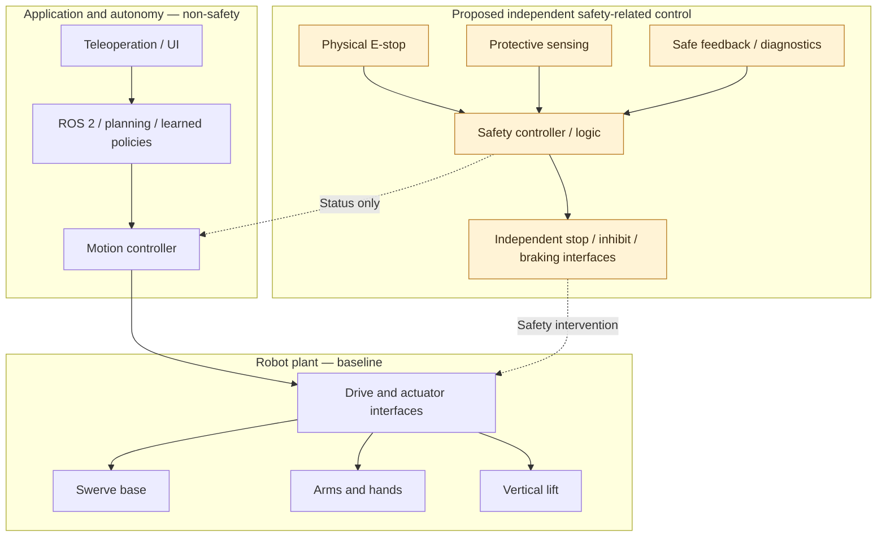
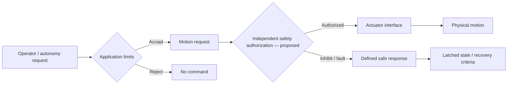
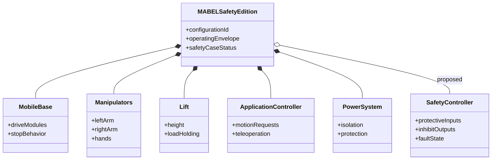
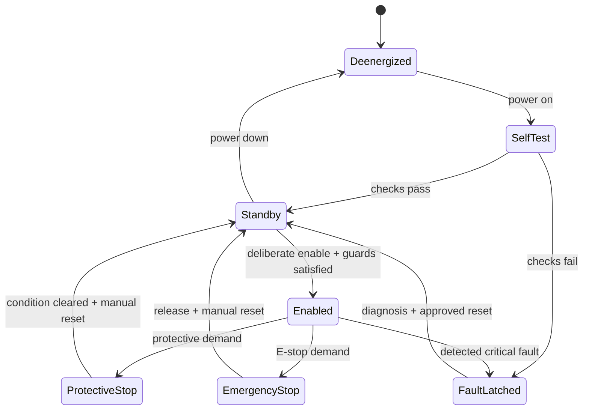
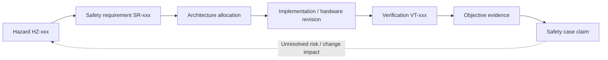
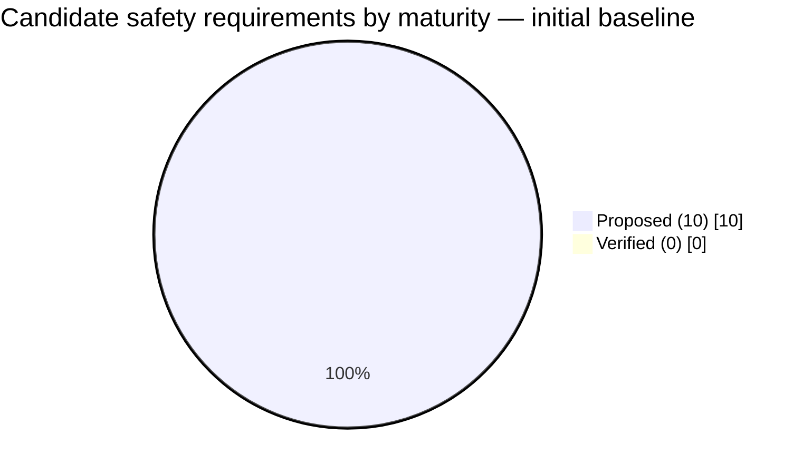
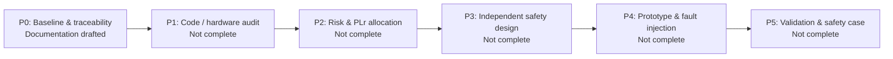

<div align="center">

# OPEN MABEL
## SAFETY EDITION

**Open robotics. Engineered safeguards. Traceable evidence.**

*A general-purpose mobile manipulation research platform with a safety-engineering development program.*

[Architecture](#system-architecture) · [Safety functions](#planned-safety-functions) · [Model](#sysml-inspired-system-model) · [Roadmap](#development-roadmap) · [Get started](#getting-started) · [Contribute](#contributing)

</div>

> [!WARNING]
> **RESEARCH / DEVELOPMENT — NOT SAFETY CERTIFIED.** This repository contains a baseline robot and **proposed** safety architecture, requirements and analyses. The independent safety controller, protective sensors, safe motion functions and hardware safeguards described here are **not demonstrated as implemented or validated**. Do not treat this project as suitable for unsupervised operation around people. No PL, SIL, certification or regulatory compliance claim is made.

## What is Open MABEL Safety Edition?

Open MABEL Safety Edition is a **distinct safety-engineering-focused development variant** of [robotmabel/open_mabel](https://github.com/robotmabel/open_mabel). The goal is to turn an open mobile bimanual research robot into a **configurable, evidence-backed safety-capable platform** for defined applications and operating environments.

It is **not** a new safety-certified robot, and is **not** an official upstream release. The existing controller and operational safety gates remain research-grade until audited. The project does not assume any single application such as logistics, cleaning or household service.

### Design commitments

| Pillar | Design intent | Current maturity |
|---|---|---|
| Independent protection | Safety functions enforceable without ROS 2, AI, Wi-Fi or cloud | **Proposed** |
| Safe motion | Monitored speed, position, stops, load retention and stability | **Requirements draft** |
| Transparent engineering | Hazards → requirements → architecture → tests → evidence | **Initial artifacts** |
| Modular platform | Hardware and software can evolve under configuration control | **Upstream baseline** |
| Open collaboration | Public designs, reviewable changes and reproducible evidence | **In progress** |

## Robot platform

The imported Open MABEL baseline describes a mobile bimanual platform with a three-module swerve base, vertical lift, pitching torso, active head, two 7-DOF arms, two dexterous hands, teleoperation, ROS 2 Jazzy, MuJoCo simulation and robot-learning tools. **These are upstream platform characteristics, not verified Safety Edition capabilities.**

| Subsystem | Baseline | Safety investigation |
|---|---|---|
| Mobility | Swerve drive modules | Safe stop, steering behavior, unintended motion |
| Manipulation | Dual arms and hands | Joint limits, pinch/crush risk, payload retention |
| Vertical motion | Powered lift | Brake, anti-drop and loss-of-power behavior |
| Perception | Cameras and other sensors | Protective coverage, diagnostic integrity and occlusion |
| Compute | Controller, firmware, ROS 2 | Isolation, watchdogs, command bypass paths |
| Power | Battery and distribution | Isolation, electrical protection and fault response |

## System architecture

The following **conceptual architecture** distinguishes the existing application stack from the proposed safety-related control boundary. Arrows show intended logical interfaces, **not confirmed wiring or qualified interfaces**.



> [!IMPORTANT]
> **Torque-off is not universally a safe state.** A lift or loaded arm can fall when torque is removed. Safe states, stopping categories, braking and load-holding must be derived and validated per mechanism and operating configuration.

### Safety separation and control authority



Application-level collision avoidance and tip-over prevention can provide defense in depth; they must not be credited as safety-rated safeguards without appropriate evidence.

## Planned safety functions

**All rows are candidate requirements, not implemented features.** Required performance levels, response times and test criteria remain to be determined through risk assessment.

| ID | Candidate safety function | Principal hazard | State |
|---|---|---|---|
| SF-01 | Emergency stop | Unexpected hazardous motion | Proposed |
| SF-02 | Protective stop | Person entering hazardous space | Proposed |
| SF-03 | Safe limited speed | Excessive kinetic energy | Proposed |
| SF-04 | Joint / workspace limits | Pinch, crush and overtravel | Proposed |
| SF-05 | Lift and payload retention | Uncontrolled descent / release | Proposed |
| SF-06 | Stability envelope monitoring | Tip-over | Proposed |
| SF-07 | Loss-of-command safe response | Stale / missing commands | Proposed |
| SF-08 | Fault detection and latched recovery | Undetected faults / unexpected restart | Proposed |
| SF-09 | Electrical isolation and protection | Shock, fire and electrical faults | Proposed |
| SF-10 | Service energy isolation | Unexpected startup during maintenance | Proposed |

Source work products: [hazards](safety/01_risk_assessment/hazard_register.csv) · [requirements](safety/02_safety_requirements/safety_requirements.csv) · [architecture](safety/03_safety_architecture/architecture.md).

## SysML-inspired system model

This is a **documentation-level structural model**, not a validated or tool-executable SysML v2 package. The accompanying [SysML v2-style source sketch](docs/architecture/mabel-safety-model.sysml) is deliberately labeled illustrative.



### Proposed safety state machine



**State-machine semantics are proposed.** Reset must not automatically initiate hazardous motion. Recovery behavior, E-stop category and protective-stop behavior require validation.

## Traceability and assurance





This chart counts **documentation maturity only**, not engineering completion or achieved safety performance.

### Safety case status

| Claim | Status | Evidence needed |
|---|---|---|
| Defined operating envelope | Draft | Approved item definition |
| Hazards and risk reduction | Open | Completed risk assessment |
| Safety architecture meets required integrity | Open | Allocations, hardware and software evidence |
| Protective functions operate as intended | Open | Fault injection and measured validation |
| Residual risk is acceptable | Open | Independent review and release decision |

See [preliminary safety case](safety/08_safety_case/claim_evidence.md).

## Standards and applicability

Standards must be selected by **intended use and product classification**, not by the presence of a robot arm or mobile base.

| Standard | Assessment role |
|---|---|
| ISO 12100 | Machinery hazard identification and risk reduction methodology |
| ISO 13849-1 / -2 | Safety-related control system design and validation, where applicable |
| IEC 60204-1 | Electrical equipment of machinery, where applicable |
| ISO 10218 | Industrial robot / robot system requirements, if classified in scope |
| ISO 13482 | Personal care robot requirements, if classified in scope |
| ISO 3691-4 | Driverless industrial truck requirements, if classified in scope |

**No compliance claim is made for any listed standard.**

## Repository map

```text
Open-MABEL-Safety-Edition/
├── README.md                    ← project entry point
├── docs/
│   └── architecture/            ← structural model and design notes
├── safety/                      ← Safety Edition assurance workspace
│   ├── 00_item_definition/
│   ├── 01_risk_assessment/
│   ├── 02_safety_requirements/
│   ├── 03_safety_architecture/
│   ├── 04_hardware_safety/
│   ├── 05_software_safety/
│   ├── 07_verification_validation/
│   └── 08_safety_case/
├── controller/                  ← upstream application control
├── firmware/                    ← upstream embedded control
├── hardware_bridge/             ← upstream actuator interface
├── hardware/                    ← upstream mechanical design
├── electrical/                  ← upstream electronics
├── ros/                         ← upstream ROS 2
├── simulation/                  ← upstream MuJoCo
├── simulation_bridge/
├── server/                      ← upstream teleoperation gateway
├── web_gui/
└── robot_learning/
```

The `docs/architecture` files are part of this redesign; other subsystem folders are imported upstream sources. This README does not claim that the repository already contains a complete independent safety controller.

## Getting started

### 1. Read the safety scope

Start with [Safety Engineering Workspace](safety/README.md), [Item Definition](safety/00_item_definition/item_definition.md) and [Hardware Gap Assessment](safety/04_hardware_safety/gap_assessment.md).

### 2. Clone and explore

```bash
git clone https://github.com/TomcoGame/Open-MABEL-Safety-Edition.git
cd Open-MABEL-Safety-Edition
```

### 3. Run the upstream research stack in a controlled development environment

Consult [controller](controller/README.md), [simulation](simulation/README.md), [server](server/README.md), [hardware](hardware/README.md) and [ROS](ros/README.md) for dependency and platform instructions. **No installation or test commands are represented as verified by this documentation update.** Prefer simulation before any physical integration.

> [!CAUTION]
> Do not energize or deploy hardware on the basis of this README. Physical testing requires an approved risk assessment, appropriate exclusion/guarding, instrumentation, emergency provisions and a validated test procedure.

## Development roadmap



| Milestone | Exit criteria |
|---|---|
| P0 — Foundation | Item definition, hazards, candidate requirements and architecture under review |
| P1 — Baseline audit | Complete actuation path map; component datasheets and existing stop behavior documented |
| P2 — Risk allocation | Approved risk assessment, required integrity and measurable safety requirements |
| P3 — Detailed design | Electrical/mechanical safety design, software boundary and reviewable schematics |
| P4 — Integration | Implemented controls with traceable bench and simulation tests |
| P5 — Validation | Measured stopping/load-holding behavior, fault coverage and reviewed safety argument |

## Contributing

We welcome robotics, functional safety, embedded, mechanical, electrical, controls and verification contributors. For safety-relevant changes:

1. Link the change to hazards and requirements.
2. Identify affected configurations and operating conditions.
3. Provide implementation rationale, verification plan and evidence.
4. Avoid unsubstantiated claims such as “safety rated,” “PL d,” “SIL 2,” “certified,” or “safe around people.”

See [safety workspace](safety/README.md) for evidence maturity definitions.

## Upstream attribution and licensing

This is an **independent derivative development effort**, based on [robotmabel/open_mabel](https://github.com/robotmabel/open_mabel), and not an official upstream safety release or certification. Preserve upstream copyright notices and third-party license obligations. The original project name and marks may have separate trademark restrictions.

- [Software license — Apache-2.0](LICENSE)
- [Hardware license — CERN-OHL-S-2.0](LICENSE-HARDWARE.txt)
- [Documentation/media — CC BY 4.0](LICENSE-DOCS.txt)
- [NOTICE](NOTICE) · [Third-party notices](THIRD_PARTY_NOTICES.md)

---

<div align="center">

**OPEN MABEL SAFETY EDITION**

*Design safety into the system. Demonstrate it with evidence.*

**Project maturity: preliminary engineering — no safety certification.**

</div>
