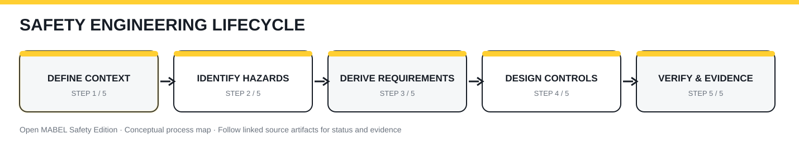

# Open MABEL Safety Edition · Visual Engineering Wiki

**Safety-Enabled Robotics · Learn → Design → Implement → Verify → Maintain**

This version-controlled documentation hub is the source for a future GitHub Wiki. It links directly to engineering artifacts in this repository, so diagrams, guides, and evidence can be reviewed together.

## Standards-driven process library

[**Explore the controlled process library**](processes/README.md) · [Master register](processes/process-register.csv) · [Standards register](processes/standards-register.csv)

Five foundational procedures are drafted for technical review. The full 36-process register tracks remaining work.

## Start here

| Guide | What you will learn | Primary artifact |
|---|---|---|
| [Getting oriented](getting-oriented.md) | Platform boundaries, current vs proposed design | [Item definition](../../safety/00_item_definition/item_definition.md) |
| [Risk assessment](risk-assessment.md) | Hazard → risk reduction → requirements | [Hazard register](../../safety/01_risk_assessment/hazard_register.csv) |
| [Safety architecture](safety-architecture.md) | Application control vs independent safety authority | [Architecture](../../safety/03_safety_architecture/architecture.md) |
| [Safety requirements](safety-requirements.md) | Traceability and acceptance criteria | [Requirements](../../safety/02_safety_requirements/safety_requirements.csv) |
| [Verification and evidence](verification-evidence.md) | Test planning and evidence linkage | [Verification plan](../../safety/07_verification_validation/verification_plan.md) |
| [Contributing visual docs](visual-authoring-guide.md) | SVG animation, accessibility and review rules | [Visual assets](../assets/README.md) |

## Four core process modules

| Module | Animated workflow | Static fallback | Editable template |
|---|---|---|---|
| [Risk assessment](risk-assessment.md) | [Play/view](../assets/wiki/risk-assessment-animated.svg) | [SVG](../assets/wiki/risk-assessment-static.svg) | [CSV](templates/risk-review-template.csv) |
| [Safety requirements](safety-requirements.md) | [Play/view](../assets/wiki/safety-requirements-animated.svg) | [SVG](../assets/wiki/safety-requirements-static.svg) | [CSV](templates/requirements-review-template.csv) |
| [Safety architecture](safety-architecture.md) | [Play/view](../assets/wiki/safety-architecture-animated.svg) | [SVG](../assets/wiki/safety-architecture-static.svg) | [CSV](templates/architecture-decision-template.csv) |
| [Verification & evidence](verification-evidence.md) | [Play/view](../assets/wiki/verification-evidence-animated.svg) | [SVG](../assets/wiki/verification-evidence-static.svg) | [CSV](templates/evidence-record-template.csv) |

These diagrams illustrate processes rather than verified robot capabilities. SVG animation may be disabled by GitHub's image proxy; open the raw SVG or use the static fallback for consistent display.

## Animated process map

[Open the standalone animated SVG](../assets/wiki/safety-lifecycle-animated.svg) · [Static fallback](../assets/wiki/safety-lifecycle-static.svg)

> Some GitHub views suppress SVG animation. All essential labels, arrows and statuses remain visible without motion.

## Documentation standard

Every process guide must define: **purpose → scope → inputs → responsible roles → activities → decisions → outputs → traceability → verification → change control**. Link to actual repository artifacts. Distinguish baseline functionality from proposed integration. Do not infer completed verification from illustrations.

## Roadmap

1. Baseline process guides and cross-links (this release)
2. One process infographic and one accessible animated SVG per guide
3. Worked examples using stable hazard/requirement/test identifiers
4. Review workflow and publication into GitHub Wiki
