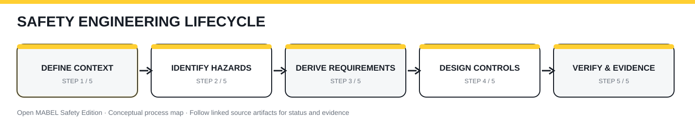

# Open MABEL Safety Edition · Controlled Process Library

**Reference application:** industrial mobile manipulation · **Status:** process architecture under development.

This library separates reusable processes from application-specific requirements and completed engineering records. The [master process register](process-register.csv) tracks **36 planned processes**; the [standards register](standards-register.csv) records editions, scope decisions and outstanding licensed-text reviews.

## First five draft procedures

| ID | Procedure | Status |
|---|---|---|
| PROC-A01 | [Safety Management Plan](PROC-A01.md) | Draft |
| PROC-A02 | [Standards Applicability & Compliance Mapping](PROC-A02.md) | Draft |
| PROC-A04 | [Document Configuration & Change Control](PROC-A04.md) | Draft |
| PROC-B01 | [Item Definition & Operating Context](PROC-B01.md) | Draft |
| PROC-B03 | [Hazard Identification & Risk Assessment](PROC-B03.md) | Draft |

## Governance rules

1. Every process has a unique ID, revision, owner, approval state, entry criteria, steps, outputs and review gates.
2. The industrial mobile manipulator profile is a reference, not a universal standard applicability declaration.
3. A standard is not marked compliant merely because it appears in the register.
4. Clause-level mappings require authorized access to the normative standard and technical review.
5. Risk analyses, safety requirements, tests and evidence stay in their authoritative repository locations.
6. Publication in the Wiki makes the procedure discoverable; it does not itself approve the procedure.

## Lifecycle overview

[Static version](../../assets/wiki/safety-lifecycle-static.svg) · [Wiki home](../README.md)
