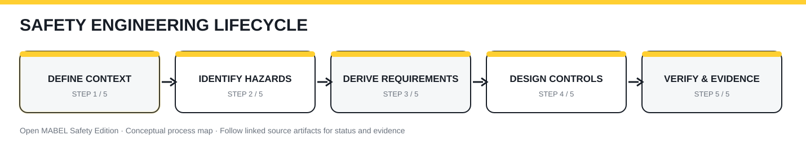

# Risk assessment workflow

[← Wiki home](README.md)

## Purpose
Identify hazardous situations and derive risk-reduction measures for a defined robot configuration and operating context.

## Inputs
[Item definition](../../safety/00_item_definition/item_definition.md), use cases, foreseeable misuse, operating modes, human interactions and subsystem constraints.

## Procedure
1. Define task, operating mode, robot configuration and exposure assumptions.
2. Identify hazards and hazardous events for base, lift, arms, hands, power and control.
3. Record causal scenarios and existing protective measures.
4. Assess risk using the selected applicable methodology.
5. Select risk-reduction measures and allocate candidate safety functions.
6. Create or revise linked safety requirements.
7. Review residual risk, unresolved assumptions and required validation.

## Outputs
[Hazard register](../../safety/01_risk_assessment/hazard_register.csv) and linked [safety requirements](../../safety/02_safety_requirements/safety_requirements.csv).

## Review gate
No risk-reduction claim is complete without a defined operating context, acceptance criterion, and verification route.
