# Risk assessment workflow

[← Wiki home](README.md)

[Open guided SVG](../assets/wiki/risk-assessment-animated.svg) · [View static storyboard](../assets/wiki/risk-assessment-static.svg)

**How to use:** Read the six cards in order. In SVG viewers that support animation, a yellow outline advances every six seconds. All information remains visible without animation.

## Purpose
Identify hazardous situations and derive risk-reduction measures for a defined robot configuration and operating context.

## Inputs
[Item definition](../../safety/00_item_definition/item_definition.md), use cases, foreseeable misuse, operating modes, human interactions and subsystem constraints.

## Procedure
1. Define task, operating mode, robot configuration and exposure assumptions.
2. Identify hazards and hazardous events for base, lift, arms, hands, power and control.
3. Record causal scenarios and existing protective measures.
4. Assess risk using the selected applicable methodology.
5. Select risk-reduction measures and allocate candidate safety functions.
6. Create or revise linked safety requirements.
7. Review residual risk, unresolved assumptions and required validation.

## Outputs
[Hazard register](../../safety/01_risk_assessment/hazard_register.csv) and linked [safety requirements](../../safety/02_safety_requirements/safety_requirements.csv).

## Review gate
No risk-reduction claim is complete without a defined operating context, acceptance criterion, and verification route.

## What the visual lesson teaches

The six cards move from **context → hazardous situation → risk evaluation → risk reduction → residual-risk review → requirements and evidence**. The example illustrates why gravity-loaded mechanisms need careful assessment; it does not prescribe a risk rating or establish that a particular safeguard is installed.

**Decision loop:** If residual risk is not acceptable, revisit risk-reduction measures, then re-evaluate before baselining the safety requirements.

## Worked example — illustrative only

**Scenario:** a vertical lift unexpectedly descends while a person is within the reachable workspace. **Hazard:** crushing or impact from gravity-loaded motion. **Potential controls:** mechanical load retention, monitored braking, controlled energy isolation, and access restrictions, subject to analysis. **Next step:** document risk assumptions and derive measurable requirements. This is a teaching example, not an assessed MABEL hazard.

## Decision checklist

- [ ] Is the configuration and operating mode explicit?
- [ ] Are human exposure and foreseeable misuse considered?
- [ ] Are initiating events and consequences distinguishable?
- [ ] Are proposed controls linked to requirements?
- [ ] Are residual risks and open assumptions recorded?

[Downloadable risk review template](templates/risk-review-template.csv)
