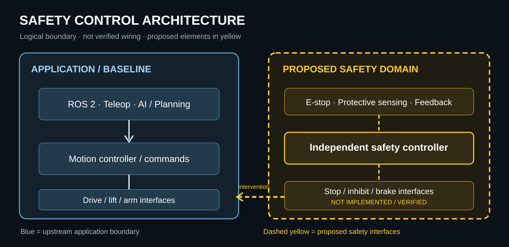

# Safety-enabled architecture

[← Wiki home](README.md)

## Purpose
Separate application behavior from the independent authority required for selected protective functions.

## Design process
1. Map control and energy paths from commands to physical motion.
2. Identify safety-related inputs, logic, outputs, feedback and diagnostics.
3. Define safety functions, safe states and transition conditions per hazard.
4. Specify loss-of-communication and fault behavior without relying on ROS 2, AI or cloud connectivity as the sole protective mechanism.
5. Evaluate gravity-loaded lift/arms and retained-energy behavior before selecting a stop strategy.
6. Allocate interfaces and diagnostics; identify hardware/software integration gaps.
7. Link architectural elements to requirements and verification cases.

## Sources
[Architecture definition](../../safety/03_safety_architecture/architecture.md) · [Hardware gap assessment](../../safety/04_hardware_safety/gap_assessment.md) · [Software boundary](../../safety/05_software_safety/software_boundary.md).

**Status:** conceptual architecture and integration planning. The infographic is explanatory, not a hardware wiring diagram.
